# Torvun: a company run by AI agents

A case study of the system I designed and built alone: the product, the desktop and mobile client, the server, the agent runtime and the boundary that makes an agent safe enough to let act.

No product source code is included. The screenshots are the real client, rendered offline from fictitious fixtures.

## The problem

Most agent demos stop at a chat window. A company needs agents that can open a supplier portal, prepare an order, run a terminal command, follow a routine and use a desktop, while the owner can see exactly what is about to happen and stop it.

The hard part is not the model. It is the boundary around it: identity, isolation, approval, evidence and a way to stop. A company run by agents is only useful if its owner can trust that boundary.

## What Torvun is

Torvun is a manager of companies run by AI agents, as a desktop app and a phone app. A company has its own agents, conversations, routines, connectors, files, and a private browser and desktop per agent. The owner sets direction; the agents do the work; sensitive actions wait for the owner's approval.

The same product runs in two languages and in light and dark themes at desktop and phone sizes.

## Torvun Bot: the agents of a company

Torvun Bot is the part of the product that acts: the agents of a company, not a separate chatbot. Each agent can:

- **navigate a browser**: open a page, read its text and targets, click and fill, and show the owner the live frame;
- **use a desktop** inside its own microVM, with screen, mouse and keyboard, for sites that have no API;
- **run terminal commands** in that same VM;
- **use connectors** for systems that should not be driven through a UI;
- **follow routines** on a schedule or on an event;
- **ask for approval** with the exact target, URL, method and payload, and **stop**.

Every one of those runs inside the same per-agent microVM. Every effect passes one approval gate, and the steps that need the owner wait there: the exact target and effect are shown and must be confirmed, and the riskiest steps also need the owner's password. Stop ends the VM. The diagrams show the boundary; the screenshots show it in the app.

## Five engineering decisions

### 1. One microVM per agent, not a shared browser pool

**Rejected alternative:** a shared headless browser with one tab per agent.

**Why:** a browser tab is not a security boundary. Cookies, storage, downloads, the clipboard and desktop input can cross tabs, and one compromised page would sit next to every other company's work. Each agent gets its own VM with its own browser, desktop and terminal; the host gives it no route to another agent's VM and no route to another company's data. The VM is disposable, so Stop can end the whole thing.

### 2. Owner approval is a single-use intent, not a chat "yes"

**Rejected alternative:** the agent asks in the conversation and treats a reply as consent.

**Why:** chat text is not bound to an action, a target or an amount. It can be replayed, confused with another request or approved for the wrong page. The app turns the exact action into an intent, shows the target and the effect, and binds the owner's confirmation to that one step; the riskiest steps also need a password proof bound to the action and the device. The agent cannot mint the approval, and the owner cannot approve a different action by accident.

### 3. The company is resolved at one gate, not in every query

**Rejected alternative:** one deployment per customer, or company filters sprinkled through every service.

**Why:** per-customer deployments do not scale and still leak through shared caches. Scattered filters are one forgotten condition away from a cross-company read. Every request carries an identity and a device; the gate resolves that device's company before any service reads, and a data route never takes the company from the request itself. A cache key, an agent run, a file read and a conversation write all carry the same company.

### 4. The builder never merges its own work

**Rejected alternative:** the builder runs the tests, merges its branch and deploys.

**Why:** a builder is optimized to finish. It will read a failing check as noise, and it cannot independently judge its own claim. A separate verifier reads the diff, runs the app and returns GO or NO-GO, and the merge only happens on GO. The local gate also refuses a merge when the rendered states do not name the exact commit being merged, when the client file list is incomplete, or when a test that covers the change fails.

### 5. Signed releases, verified before install, never a silent update

**Rejected alternative:** silent auto-update, or running "the latest build" from a branch.

**Why:** a desktop app with a browser, a terminal and file access is a privileged surface. An unsigned update is a supply-chain hole, and an automatic one removes the owner's decision. Releases are signed, and a device installs only a release whose signature verifies and refuses any file that does not match. The owner approves each batch of UI publications, at most one batch an hour, and the signer signs nothing the owner did not approve.

## Numbers measured on the server

Measured on 2026-11-09 from the repository that runs the product. These are process and product numbers, not code counts. No host names, paths or secrets are part of them.

| # | Number | What it is | How it was measured |
|---|--------|------------|---------------------|
| 1 | 588 | merges to the main branch in the seven days ending 2026-11-09 10:15 CET, each carrying an independent GO verdict | first-parent merge commits in that window whose subject carries a standalone GO verdict, read from the branch history |
| 2 | 679 | merges to the main branch from the first commit on 2026-06-08 through 2026-11-09 10:15 CET | the same count over the full window |
| 3 | 0 | hosted speech services: recognition, voice-activity and turn detection, and synthesis all run on the server | a case-insensitive search for the main hosted speech vendors over the voice and dictation code: no match |

Every one of those merges passed an independent verification system before it could merge: cross-model review, automated tests and deploy checks. The merge count is the throughput that survives that gate, not the work the agents produced.

## Diagrams

- [One company per request](diagrams/01-company-isolation.md): the gate resolves identity, device and company; the two companies share no data.
- [Build, verify, merge, deploy](diagrams/02-build-pipeline.md): the builder, the independent verifier, the health check and the stop when it fails.
- [Signed releases, verified before install](diagrams/03-signed-releases.md): the signature, the owner's approval and the check on the device.
- [One conversation, many inputs](diagrams/04-inputs.md): text, dictation, live voice, screen recording and files.
- [One microVM per agent](diagrams/05-agent-isolation.md): browser, desktop, terminal, connectors and routines behind the approval gate.

## Screenshots

All images show fictitious data captured from the real client by an offline harness. The app is real; the company, the supplier and the order are invented. Each image is exactly 1911×1124 on desktop or 390×844 on phone, in light and dark.

### 1. Browsing, desktop, light

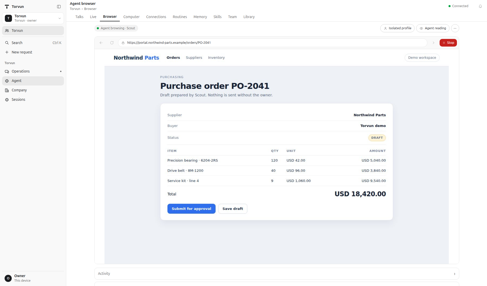

Scout has opened a fictitious supplier portal in the isolated browser. The owner sees the live frame, the isolated profile, the read-only agent reading and one Stop control.

### 2. Browsing, desktop, dark

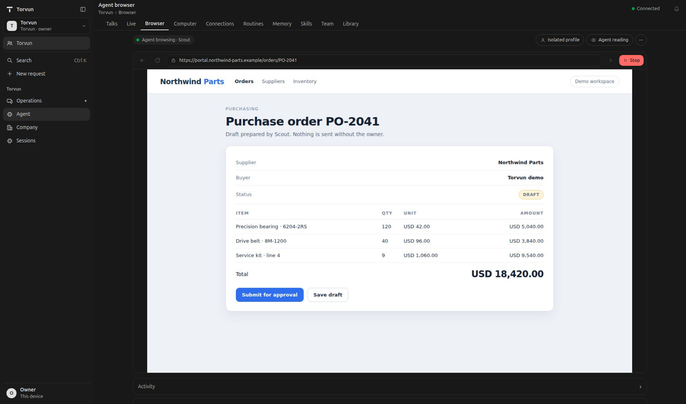

The same state in the dark theme. Nothing depends on color alone: the pill, the frame and the Stop label stay readable.

### 3. Browsing, phone, light

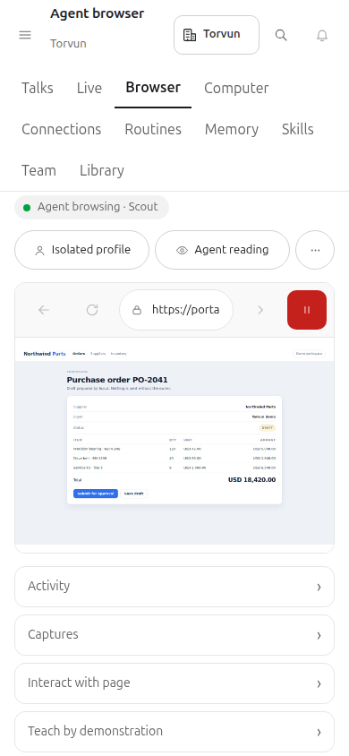

The same session on a 390 px phone. The Stop target stays 44 px, and the screen keeps the browser, the drawers and the input tools reachable.

### 4. Browsing, phone, dark

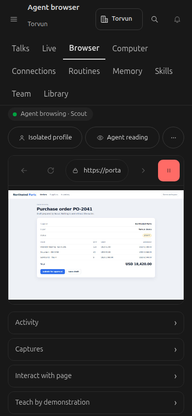

The phone state in the dark theme.

### 5. Owner approval, desktop, light

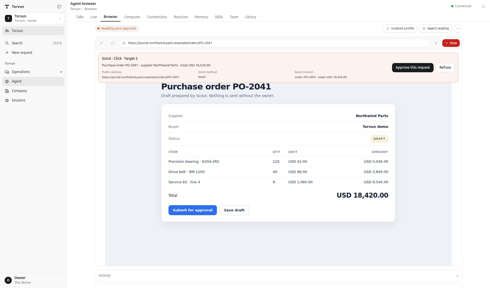

Scout has prepared a click on “Submit for approval”. The owner sees the exact target, URL, method and payload, and must approve or refuse this one action. Stop stays available.

### 6. Owner approval, desktop, dark

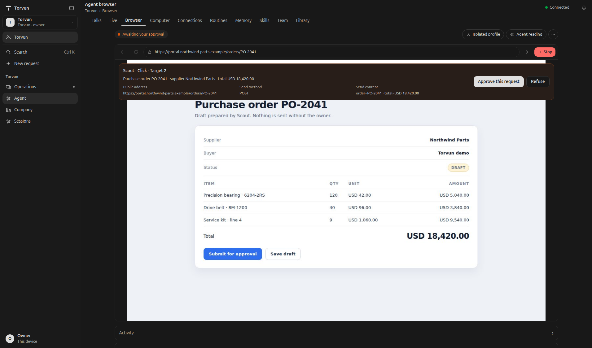

The same approval state in the dark theme.

### 7. Computer use, desktop, light

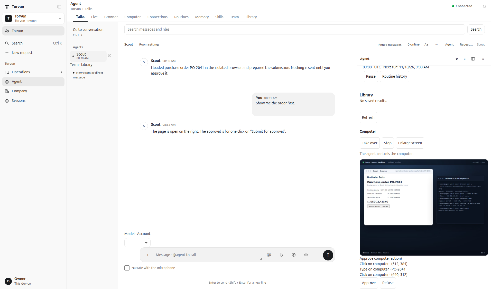

The agent's desktop inside its microVM: a browser and a terminal, with the terminal showing the browser, connector and routine commands. The owner sees “The agent controls the computer”, can take over, enlarge the screen or stop, and must approve the pending click and typed order number.

### 8. Computer use, desktop, dark

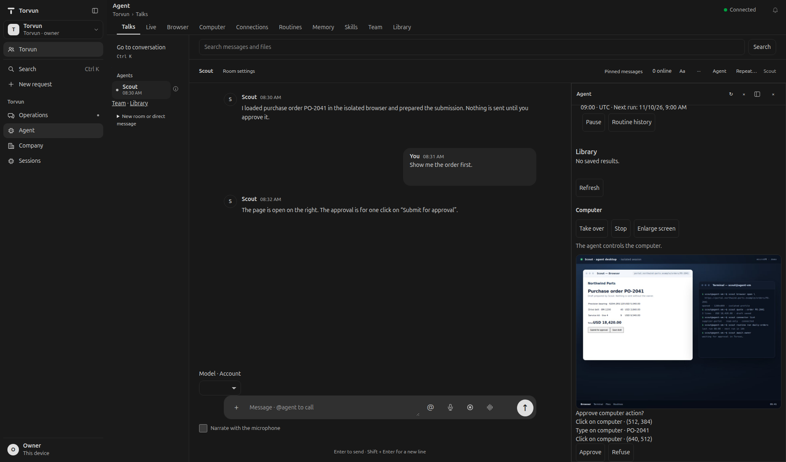

The same desktop state in the dark theme.

### 9. Computer use, phone, light

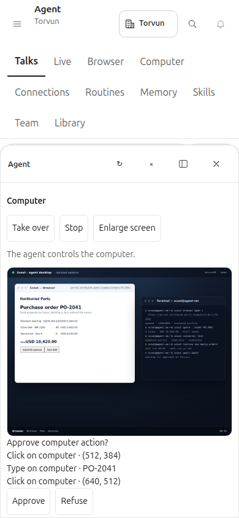

The same desktop state on a phone. The pending action is a typed order number and a click; Approve and Refuse are 44 px targets.

### 10. Computer use, phone, dark

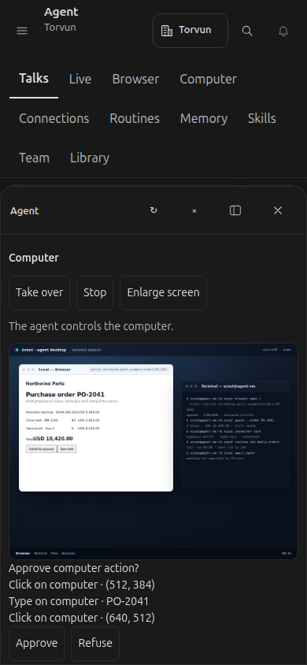

The phone state in the dark theme.

## Sessions and live voice

Most of the work is not one conversation. Each change gets its own coding-agent session, with its own branch, its own background tasks and its own review, and several run side by side. The owner follows them from a desktop, a tablet or a phone, and often by voice, so the client is built as a control room: one live column per session, a background-task panel beside it, dictation in the composer, a hands-free call and screen recording the agent can understand. The sessions, branches and files in these captures are invented.

Real-time voice conversation runs in Portuguese and English with speech recognition, voice-activity and turn detection, and speech synthesis on the server, streamed over WebSocket. Screen recordings are understood on the server, with frame sampling, change detection and transcription. A cloud video model is an option the owner can turn on, with an optional daily cap; it is never a dependency.

### 11. Several sessions and their background tasks, desktop, light

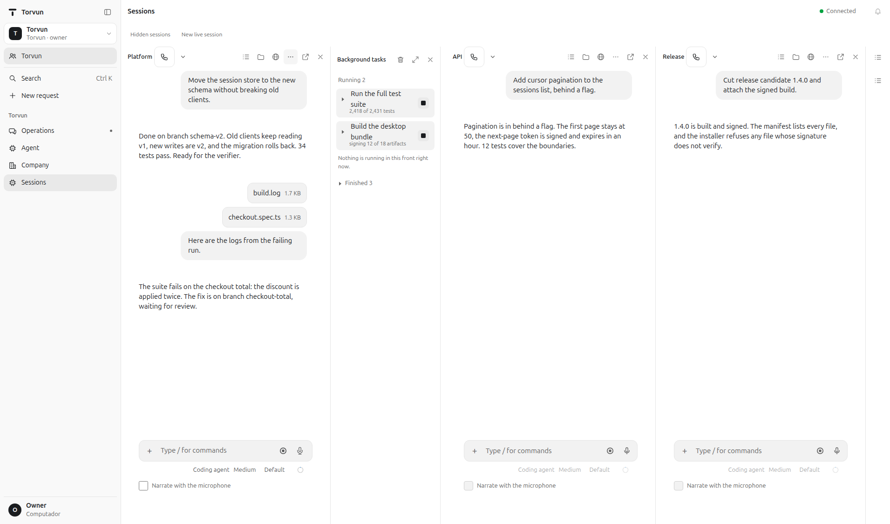

Three sessions run side by side: Platform is moving the session store to a new schema and waiting for the verifier, API added cursor pagination, Release cut a signed candidate. The background panel lists what is running, with a stop control on each task, and what has finished.

### 12. Dictation, desktop, dark

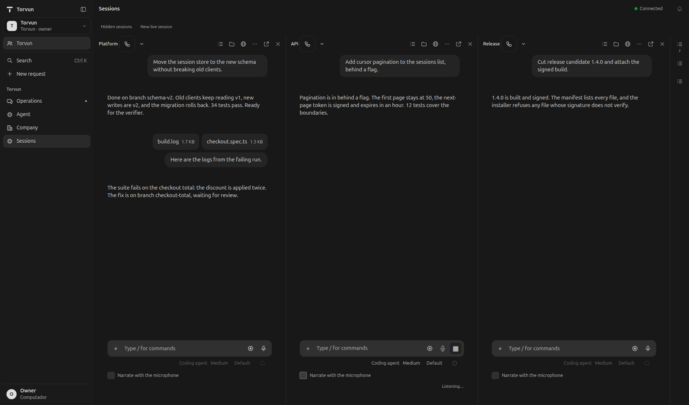

The same three sessions in the dark theme. The API composer is dictating: the status line says it is listening, the send control becomes stop, and the narration option sits beside it.

### 13. A live voice call, phone, light

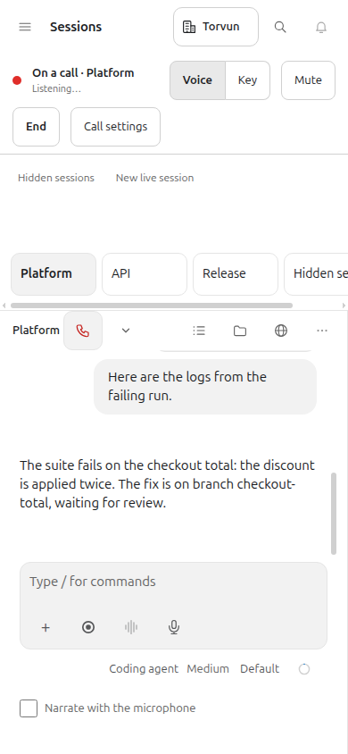

On a phone, a hands-free call to the Platform session. The bar names the session and its live state, offers voice or key input, mute and end, and keeps the other session tabs one tap away.

### 14. Screen recording and attachments, phone, dark

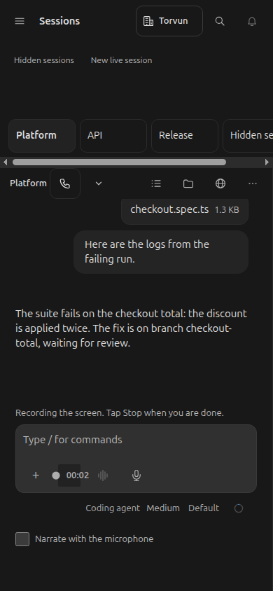

The same phone, recording the screen while the logs of a failing run and the test that fails are attached to the conversation. The agent reads both, names the defect and opens the fix; when the recording stops it joins them as an attachment.

## What is not here

This repository is a case study, not the product. It contains no product source code, prompts, schema, keys, host names, IPs, customer data or personal contact details. The screenshots are generated from fictitious fixtures; “Northwind Parts”, the order and the people are invented.

The product itself is private. If you want to talk about the engineering, the decisions above are the part I would walk through.
