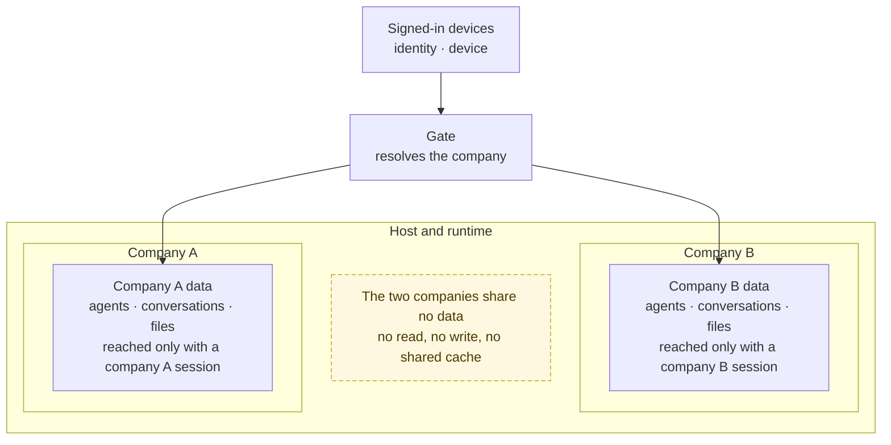

# One company per request

Every request is resolved to exactly one company before a service reads a row. The gate checks the identity and the device, and the company comes from that check, never from the request itself.

The gate is the only place that turns a session into a company. Services receive the resolved company; they do not re-read one from a query string. A cache key, an agent run, a file read and a conversation write all carry the same company, so a forgotten filter in one endpoint cannot cross the boundary.
