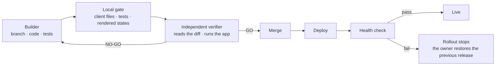

# Build, verify, merge, deploy

A change is built and tested on a branch. Before it can reach the main branch, an independent verifier reads the diff and runs the app. The builder never approves its own work.

The local gate runs before the verifier and checks what a machine can check: the client file list, the tests that cover the change, and the rendered states at the exact commit being merged. The verifier checks what a script cannot: whether the change makes sense, whether the app behaves, and whether the report is true. The merge happens only on GO. After the merge the deploy restarts the service and checks its health; if that check fails, the rollout stops before the new UI is published and the owner restores the previous release.
