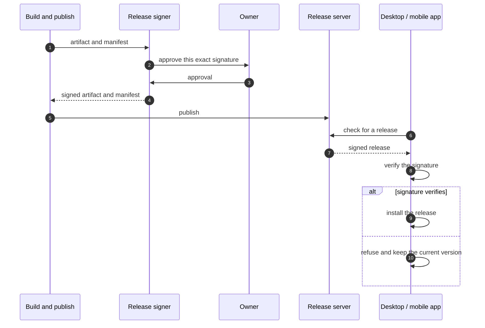

# Signed releases, verified before install

The desktop and mobile client can open a browser, a terminal and files. That makes an update a privileged operation, so every release is signed and a device installs only a release whose signature verifies.

The signing key is not on the builder. A device verifies the artifact's signature before it runs it; a release that fails the check is refused and the current version stays. The owner approves the signature for one exact batch and the batch is published at most once an hour; that approval does not replace the check, so a release that does not verify is never installed.
