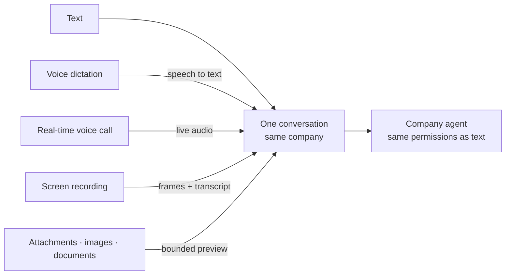

# One conversation, many inputs

Text, voice and files arrive in the same conversation and under the same company. The input mode changes how the content is captured, not who can see it or what the agent may do with it.

A dictated sentence, a call turn and a typed instruction are treated as the same kind of request by the agent. Attachments and recordings are bounded before they reach the model; they do not become a side channel around the company boundary.
