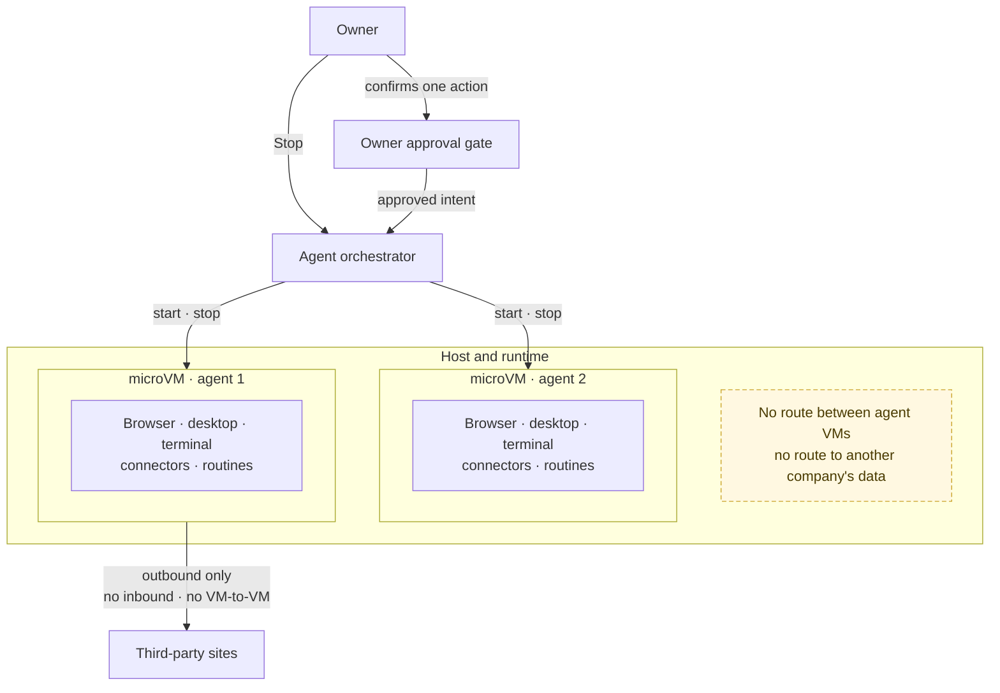

# One microVM per agent

An agent is not a browser tab. Each company agent runs in its own microVM with its own browser, desktop, terminal, connectors and routines. The host gives it no route to another agent's VM, no route to another company's data and no inbound route from third parties.

The agent can browse, click, type, run a terminal command, use a connector or follow a routine, because the thing it acts inside is disposable and isolated. The owner is not trusting a chat message: the approval gate binds one exact intent, with a target, a payload and an expiry, to one confirmation, and the riskiest steps also need the owner's password. Stop ends the VM. That is the difference between an assistant that talks about work and an agent that can be allowed to do it.
